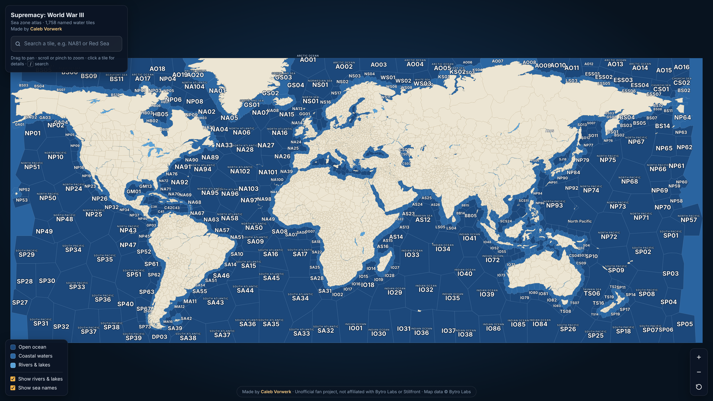

# Supremacy: World War III — Sea Zone Atlas

An interactive map of every named water tile in **Supremacy: World War III**: 1,758 open-ocean, coastal, river and lake tiles, each labeled with its in-game name and code.

**[Open the map →](https://YOUR-USERNAME.github.io/supremacy-ww3-sea-zones/)**

## Features
- Every sea zone labeled with its in-game code (NA81, AS12, IO41 …) and sea name
- Search by code or name: type `NA81` and it flies straight there
- Click any tile for details; hover for a quick tooltip
- Smooth pan and zoom with mouse, trackpad or touch
- One self-contained HTML file that works offline

## Notes
- Tile names and shapes come from the **World War 3** world map as of November 2026. Other maps (Overkill, World Redux, etc.) use different tiles.
- Coastlines are slightly simplified to keep the file small.

## Credit
Made by **Caleb Vorwerk**.

Unofficial fan project. Not affiliated with or endorsed by Bytro Labs or Stillfront. Supremacy: World War III and its map data are © Bytro Labs.
